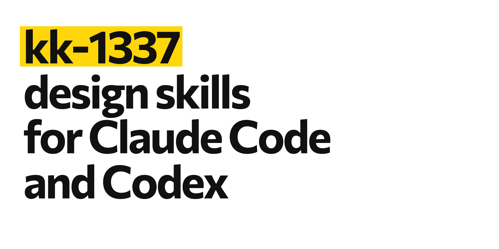
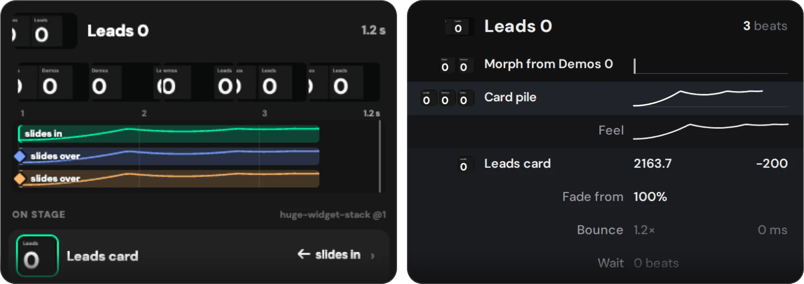
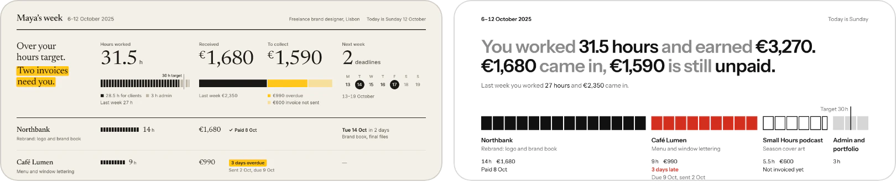
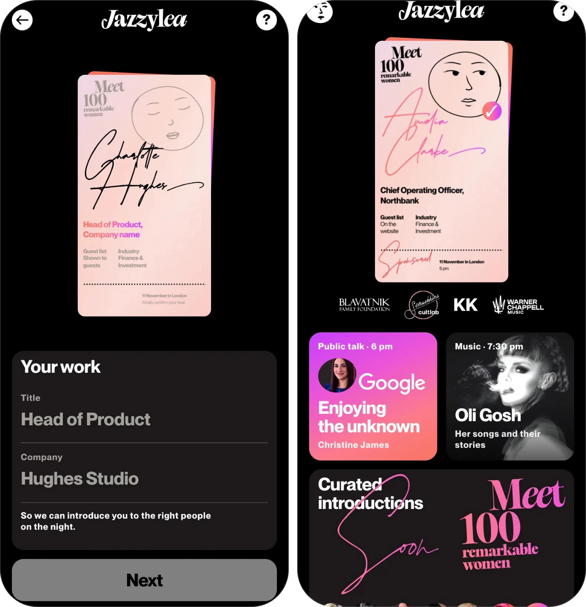
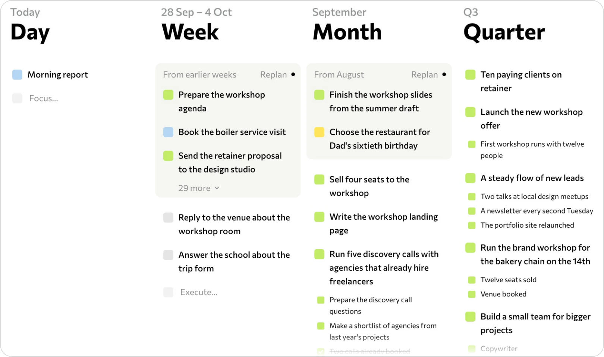

<picture>
  <source media="(prefers-color-scheme: dark)" srcset=".github/hero-dark.png">
  
</picture>

Seven skills for anything a person will see, read, decide or act on: a screen, a flow, a page, a message, a CV, a deck. They are distilled from about 340 comments [KK](https://kk.consulting) (Konstantin Konstantinopolskii) made on agents’ design&nbsp;work.

## It checks its work like KK

Before you see anything, the agent runs ten checks from his comments across 13 projects. Here is one, nothing without a job. On an agent’s panel for an animation editor, KK wrote: “You can have a sparkline, but you draft a whole control center. For what?” First that panel, then the one he approved six rounds&nbsp;later:<br><picture><source media="(max-width: 600px)" srcset=".github/checks-phone.webp"></picture>

One comment for each check, and more of his words in [what-kk-sees.md](skills/kk-taste/what-kk-sees.md):

- The whole task, and only it: “This is almost the idea that I was sharing with you, but less elegant.”
- The whole job, every click: “what if I click other?”
- One form, one meaning: “Right now click on the video opens a photo. That’s stupid.”
- One system: “We don’t have such buttons anywhere. Rounding is wrong here. Check our components.”
- Magic: “It doesn’t feel magical.”
- Nothing without a job: “Red is red. This color is redundant. Kill.”
- The words: “human that reads it for the first time should understand key values … in fraction of a second”
- The layout, to the pixel: “didn’t u see that you have a long name and it doesn’t fit the line?”
- The soul: “Cluttery, noisy, dirty shadows, not fluffy and clean at all.”
- Checked, not assumed: “if you will blur the page you will see that it’s not helping eye to scan.”

## Without and with the skills

One run each, on Opus 5.5, with the same data and the same words: “Make me a page that shows my freelance week at a glance. … Make it look great.” Without the skills, four big numbers sit side by side on a cream page; with them, one sentence carries the week, and the late invoice is the only&nbsp;red.<br><picture><source media="(max-width: 600px)" srcset=".github/compare-phone.webp"></picture>

## Made with it

### Jazzylea

An evening off-script for women who lead, in London, with the Blavatnik Family Foundation and Warner Chappell Music as partners; KK is its strategy and execution partner. Its homepage and guest app were designed with these skills: five questions fill in her ticket as she answers, and then her home opens. Live&nbsp;at [jazzylea.com](https://jazzylea.com).<br><picture><source media="(max-width: 600px)" srcset=".github/jazzylea-phone.webp"></picture>

### Verticals

KK’s open-source goal board: every goal sits in a span of time, from today to a whole life. You write a thought, and the agent files it under its goal; each morning it writes a report from the board, the calendar and messages. Its Inbox, Documents and morning report took eleven rounds with these skills over two days. Shown with sample goals; the code is&nbsp;at [konstantinopolskii/verticals](https://github.com/konstantinopolskii/verticals).<br><picture><source media="(max-width: 600px)" srcset=".github/verticals-phone.webp"></picture>

## How the work goes

- The agent asks first: one short message with how it reads your task, marked as assumptions, and up to five questions. For a review, one of them is how deep to go: a quick look or a full review. Correct it, and the work starts.
- A simple task goes straight to the result: a page, a document, a small change, or content for a platform, whose sizes, crops and rules become part of the brief.
- A product or a flow goes in three steps: bold marker sketches of whole flows, then high-fidelity shots of the two or three hardest moments, then the build.
- A review comes back as a page you answer in: select any words to comment, press Copy and paste the comments into the chat. Each finding shows the fix, in full detail when that is quick and as a bold marker sketch when it is real work.
- Your calls stay yours: where there are real options, the agent shows them with its pick and builds none until you answer.

## The seven skills

They share one question: what must this person, at this moment, perceive and do, and what is the least that delivers it, with the most force, in a form that is only this product’s?

- kk-1337: the way of thinking, the laws of how people see, think and act, and how the work goes
- kk-shaping: where a task really breaks, what fixing it is worth, and the answers, before anything is drawn
- kk-interface: everything the hand does, with controls, states, errors, undo and navigation
- kk-typography: what the text says, how it is set and where it sits
- kk-look: the soul of the look, its contrasts, colour, type, pictures and icons
- kk-motion: everything that moves, and how to measure it
- kk-taste: KK’s taste, with the screens he believes are good and the few he rejected, his cases, and what he catches in a review

## Install

The skills work best on Opus 5.5 or Sonnet 5.5 in Claude Code and on GPT-6-Astra in Codex, at medium to xhigh effort.

**Claude Code**

```
claude plugin marketplace add konstantinopolskii/kk-1337
claude plugin install kk-1337@kk-1337
```

Start a new session, and the skills are there. They add about 1,800 tokens to every session; a skill’s full text loads only when it is used. To update, turn on auto-update in `/plugin` → Marketplaces, or run:

```
claude plugin marketplace update kk-1337
claude plugin update kk-1337@kk-1337
```

**Codex**

```
git clone https://github.com/konstantinopolskii/kk-1337.git ~/kk-1337
mkdir -p ~/.codex/skills && cp -R ~/kk-1337/skills/* ~/.codex/skills/
```

To update, pull and copy again:

```
git -C ~/kk-1337 pull && cp -R ~/kk-1337/skills/* ~/.codex/skills/
```

<details>
<summary><b>Claude app (claude.ai and desktop)</b>: not tested yet</summary>

<br>It may refuse: the app’s help page limits a skill’s description to 200 characters, and these run to about 1,000. To try, zip each folder in `skills/` on its own, with the folder at the root of the zip, and upload it in Customize → Skills → + → Create skill (Pro, Max, Team or Enterprise, with code execution on).

</details>

**For the page checks**

The skills check a page the way people see it: on a desktop and an iPhone, then blurred and in grey for the hierarchy, with its sizes, colours, targets and contrast measured. That needs Node.js and Playwright; everything else works without them.

```
npm install -g playwright
npx playwright install chromium
```

## Using it

Ask in plain words; the skills load on their own when a task has something people will see or read. To call one directly, type `/kk-1337:kk-1337` in Claude Code or `$kk-1337` in Codex. For example:

- “Review the sign-up on https://…”
- “Make my CV in Google Docs”
- “Design a Reels cover for this video”
- “Sketch the onboarding flow for our app”
- “Review the settings window of my Mac app”
- “Rewrite this email so it’s clear at a glance”

## Your own taste

The pack carries KK’s taste in kk-taste. To add yours, write it in `~/.kk-1337/me.md`: the products and pages you think are good and why, what you never want to see, and how you like to review. The skills read that file first and follow it over their defaults, and after a round of your comments they offer to add what you taught them.

## Work with KK

KK, in his own words: “Growth expert. 30K MAU app owner. $1M+ B2B cases. 18 mentees with $700K ARR. Two cats.” He supervises the strategy of founders and teams in weekly 30- or 60-minute calls, and a demo session is free: [kk.consulting](https://kk.consulting).

## Sources

Besides KK’s comments and cases, the skills stand on the Bureau Gorbunov’s school of design, Maxim Ilyakhov’s information style, Lyudmila Sarycheva’s editing, Feynman’s plain explaining, Ryan Singer’s Shape Up, Ilya Birman’s and Emil Kowalski’s work on motion, [Kirill Belyaev’s portfolio](https://kirillbelyaev.com), and the research on perception and behaviour cited in each skill.

## License

MIT, © 2026 Konstantin Konstantinopolskii. Use it and change it; keep the notice.
